# rustling-tulip

rustling-tulip is a desktop app for Windows and Apple silicon Macs for running many Claude Code sessions side by side, across your repos and multi-repo workspaces. A background daemon owns every terminal, so sessions keep running when you close the window and come back after a reboot. Each session can get its own git worktree and branch, and the sidebar shows which sessions are working, which have finished and which need you. It runs the `claude` CLI you already have; it never calls the Anthropic API itself.

It is alpha software.

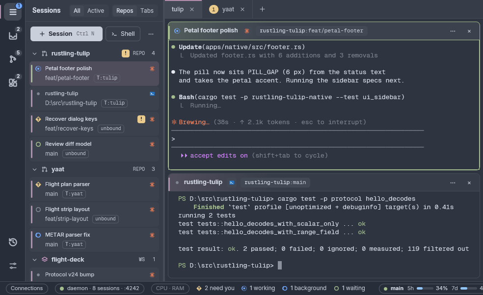

## Features

### Sessions and the sidebar

- Start a Claude session or a plain shell in a repo's own folder, or in a new git worktree on its own branch, so parallel sessions never edit the same checkout.
- Group repos into a workspace: one session works across all of them, with their relative paths kept. A VS Code `.code-workspace` file next to a repo is offered as a workspace.
- Every session's status has its own shape and colour: working, asking you something, finished while you were away, idle, or idle with background work still running.
- Tab pills and, on Windows, a badge on the taskbar button count the sessions that need you, and show nothing at zero; Settings can show busy or idle counts instead.
- The Needs You panel lists every session waiting on you, longest wait first, with what each asks: its question, the tool it wants to run, or the plan to approve. A notification fires when a session needs you or finishes (skipped when you are already looking at it), after a wait you choose for Finished.
- Notifications can be the app's own toasts, which answer a prompt or go to its pane without taking focus; on macOS they always are. Each kind plays its own sound, silent during Do Not Disturb: a chime from the bundled list, your own .wav or .ogg, or none.
- Turn on session summaries in Settings › Dashboard and each finished turn of a Claude session gets a one-line summary, kept across restarts, with a daily cap on what they spend.
- The Dashboard tab, opened from the activity rail, opens on a Compact view of every running agent by repo, with its state, work and subagents and no scrolling. Its By status view adds context, recent work, cost, a two-hour activity bar and the Linear issue named in each session's branch, with a drawer per session.
- Answer a session's question or permission prompt from the Dashboard with one click, or jump to its pane; the header counts today's cost, tokens and commits across every session.
- `rustling-tulipd` drives sessions from a shell or a script: `sessions`, `read`, `spawn`, `send`, `kill`, `wait` and `watch`, each with `--json`.
- Open a repo's, workspace's or tab's menu from the keyboard with Shift+F10 or the Menu key.
- Tabs and split panes: drag a pane or a sidebar session onto a pane to split, swap or move it, rearrange a tab into a grid, and undo a closed tab or a moved pane.
- The sidebar groups sessions by repo or by tab, in Comfortable or Compact rows, and can show every session under a repo, only the busy ones, or just a count.
- Repos sort with the ones that need you on top, by latest activity, or in your own order, and an All / Active switch hides the repos and workspaces with nothing running.
- Right-click a repo or workspace for a Spawn submenu: Last, each agent, Shell and your presets. The New session dialog picks its target from a list that narrows as you type, and remembers your Trusted choice.
- Pick each host's default shell for new sessions and shells, from the shells installed there (PowerShell, cmd, Git Bash, WSL, Nushell, fish, zsh or bash) or your own command. Claude sessions start inside it.
- Launch again with one click: a repo's last launch settings are replayed from its row. Presets start many sessions at once from a prompts file, a folder or GitHub issue ranges, and on a remote host the wizard takes typed paths on that host.
- In the terminal, copying from Claude Code's boxed panels leaves out the borders, URLs open with Ctrl+click, a file path opens in its default app with Ctrl+click and in the viewer with Ctrl+Shift+click, shell commands get a pass/fail mark in the gutter with copy and re-run, and two header buttons jump between the prompts you sent.
- Terminal programs that ask for urxvt or pixel-precise mouse reporting get clicks, drags and the wheel in the format they asked for.
- When Claude exits, its pane stays a working shell, and its Chat and Summary views turn off until Claude starts again.
- Start Claude yourself in a plain shell, by name, an alias or a wrapper, and the pane gets Chat and Summary while it runs. Settings › Claude can install the app's hooks in Claude Code's own settings, so such a Claude reports its conversation and status too.
- On macOS hosts, programs that ask the terminal for its colours, such as bat and delta, get your theme's.
- Secret environment values you give a session are stored in Windows Credential Manager, never in a settings file.

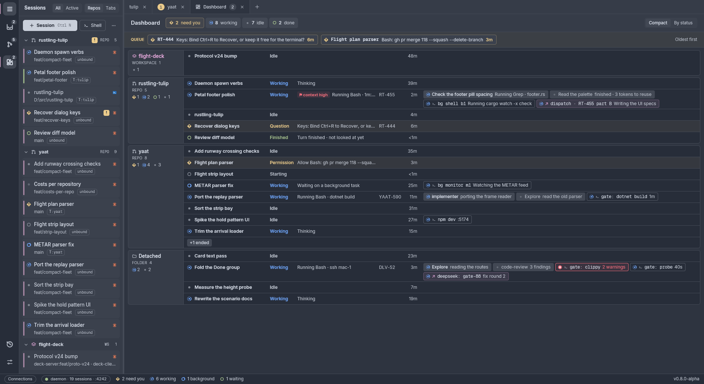

### Chat and summary views

- A Claude session's pane can show its conversation as a chat instead of the terminal (the pane's Chat button, its menu or Ctrl+Shift+M), with answers appearing as they are written. Each session remembers which view it was last shown in.
- Answer Claude's questions and permission prompts from cards, by click or key, and send messages from a box under the chat that keeps your text when a send is refused.
- A strip under the chat shows what is still running: subagents, background shells and the next wakeup, with their ages.
- A Bash or PowerShell card shows its command one statement per line, and a command that writes a log offers Tail: a scrolling box under the card that follows the file as it grows.
- The Summary view (Ctrl+Shift+U) shows a session as one line per stretch of work, each opening into its messages.
- Long replies written as expandable text open a short phrase into its longer form with a click, one level at a time.
- Compact mode, on by default, folds a run of reads, searches and commands into one line you can open. The chat column keeps a readable width on wide panes, and each turn's final answer sits in its own box.

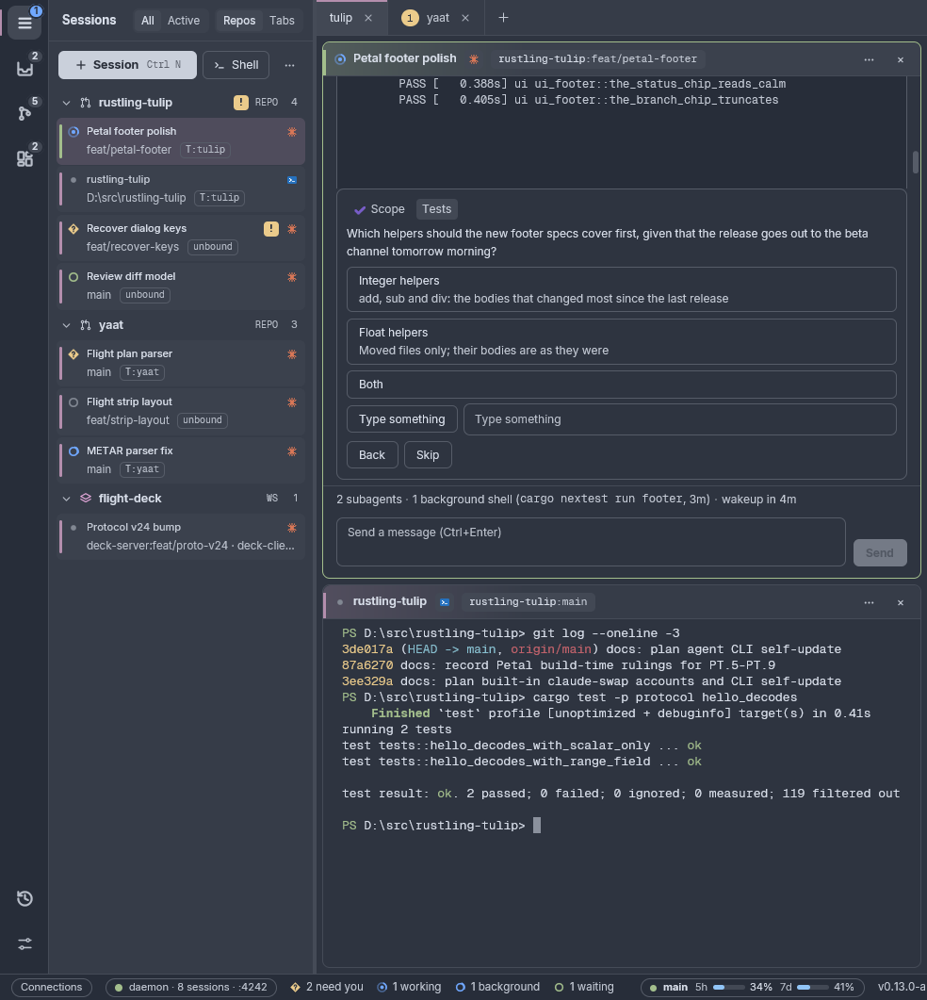

### Claude accounts

- Save several Claude logins and switch between them. The footer shows the account in use with its five-hour and weekly usage; click it to switch, turn auto-switch on and see when your accounts run dry.
- Settings › Accounts lists your saved accounts to switch, rename, reorder, remove or add, logs in a new account in a terminal session, and sets auto-switch's threshold, cooldown, strategy and forecast window.
- A toast tells you when auto-switch changes accounts, finds every account used up, or stops.

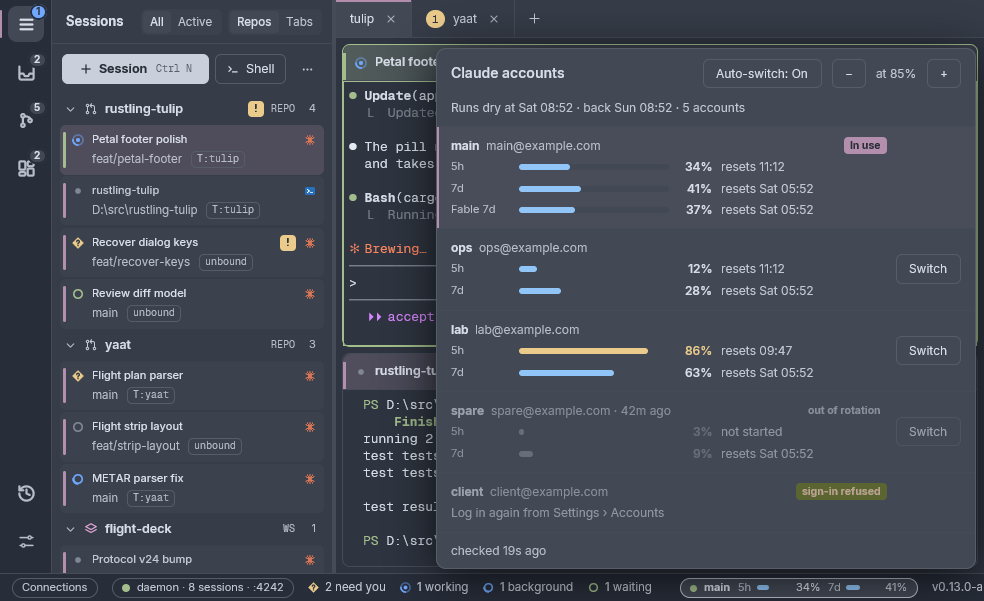

### Gates

- On Windows, a Gates view on the activity rail shows this PC's gate slots, the runs holding them, waiting gates and the queue, and sets each pool's slot count. Each row shows its command's usual time beside its own.
- It lists the last two hours' gated runs with how each ended, and the last seven days' most frequent passed commands. A footer pill counts busy slots and names a run that failed in the last ten minutes.

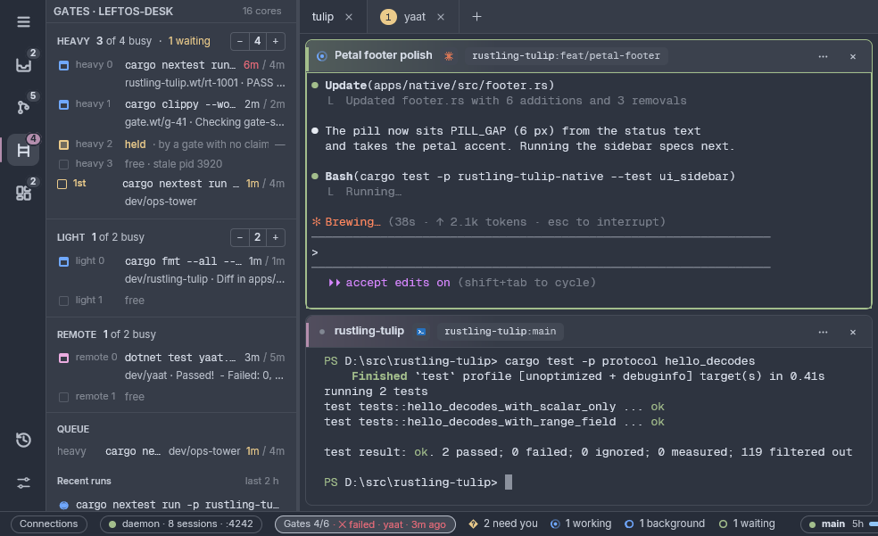

### Several hosts in one window

- The app connects to this PC and every saved host you switch on, over Tailscale or SSH, and keeps each host's sessions, alerts and panels.
- The sidebar groups sessions by host, each with its own + Shell; remote panes and tabs carry their host's name, one tab can mix panes from several hosts, and an offline host dims until it reconnects.
- Spawning, shells, Add repo, presets and Settings work on any connected host: the spawn picker groups repos by host, and Settings has a host selector.

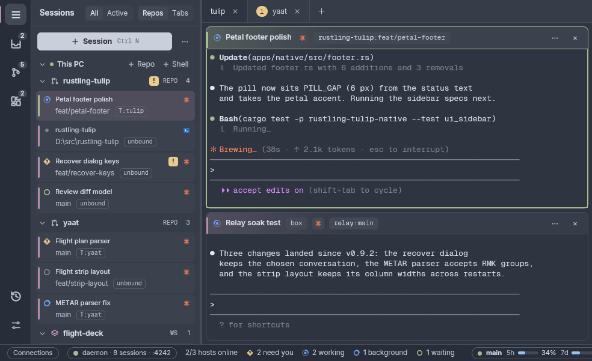

### Remote access over Tailscale

- Turn on remote access in Settings and your other PCs on your tailnet can open this PC's sessions. The daemon serves only your tailnet, over TLS with a Tailscale certificate.
- The host picker lists your tailnet machines and the hosts you saved, and the app connects to every saved host you have switched on when it starts.
- A new device has to be approved on the host PC with a one-time pairing code. The Devices list shows who is connected and when each device was last seen, and Block cuts a device off until you forget it.
- Ctrl+click a file path in a remote session's terminal, or use Fetch file…, to copy the file to this PC and open it. An HTML page brings its images and stylesheets with it.
- Ctrl+click a folder path to fetch the whole folder, with progress and Cancel, leaving out `.git`, `node_modules` and caches. A fetched file's notice offers Fetch whole folder, and a fetched folder's offers Reveal.
- When a host's session count changed since your last visit, the app offers to keep your layout, open all its sessions or start empty.

### Remote access over SSH

- Without Tailscale, connect to another Windows PC over SSH: + Add host in the Connections picker, switched to SSH, takes an alias or user@host, and Test connection checks it first. SSH hosts are Windows PCs for now.
- The installer puts its folder on your user PATH (and uninstall takes it off), so `rustling-tulipd` runs by name from a terminal or an SSH login.

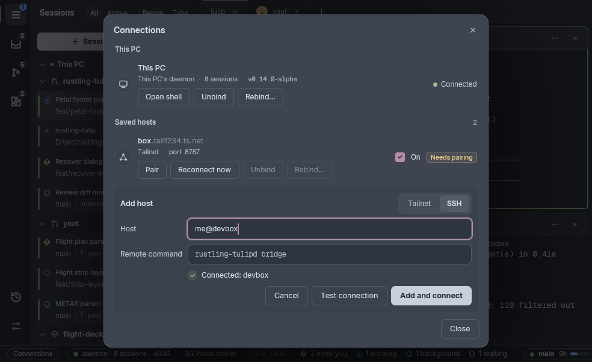

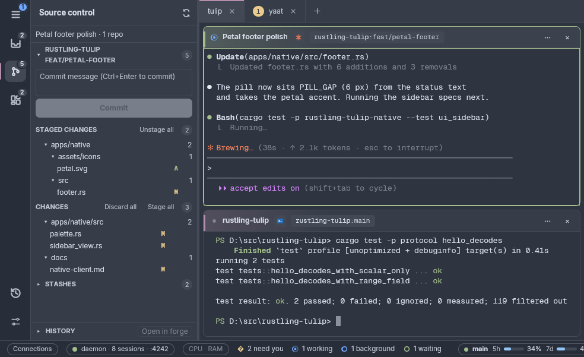

### Source control and diffs

- Each worktree's changes, staging, commit, discard, stashes, history and commit details, with a link to the commit on your forge.
- Side-by-side diffs with word-level changes, syntax colours, an overview ruler and F7 / Shift+F7 to step through changes.
- Deleting a worktree deletes its branch only when its commits have already landed; otherwise it asks, branch by branch.

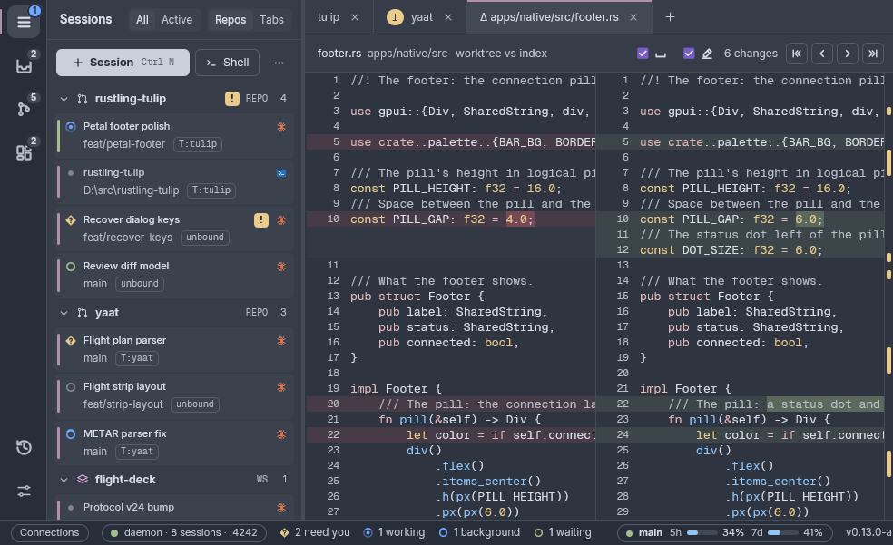

### Text and Markdown viewer

- Ctrl+Shift+click a file path in the terminal and it opens in a read-only viewer tab with line numbers and syntax colours, scrolled to the line the path names. A bare file name after a full path on the same line opens from that path's folder.
- Markdown files open rendered (headings, lists, task boxes, tables, code blocks), with a Rendered / Source toggle. Links open, and `#heading` links scroll to the heading.
- Ctrl+F finds text, a click or drag selects whole lines to copy, and a tab re-reads its file when you come back to it and the file has changed.

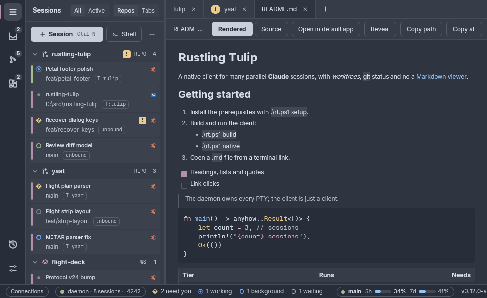

### Windows and pop-outs

- Pop a pane, a whole tab (a grid or a diff) or a session out into its own window, for a second monitor or a diff beside your work.
- A popped pane or tab leaves a card in the main window with Focus window and Dock back. Dock back returns it to the main window.
- Pop-out windows reopen where you left them the next time the app starts.

### Recovery after a reboot

- Sessions run under a small supervisor process each, so closing the window or restarting the daemon never kills them.
- After a reboot or a crash, Claude sessions resume on their own at the next start (`claude --resume`) in their old panes, with their names and colours, and a notice says how many came back.
- Anything that could not resume waits in Recover sessions, which lists the last 7 days of ended sessions with the lost ones ticked.

### Settings

- A page per agent: Claude's permission mode, its provider (Anthropic, or DeepSeek with your own `DEEPSEEK_API_KEY`), and its launch command, so you can run another program, an alias or extra arguments.
- Trusted launch by default, which notifications to show and when to skip them, and whether to keep the PC awake (off, while a session is busy, or always).
- Start the daemon at login, the folder worktrees go in, and Manage worktrees to clean up old ones.
- Appearance: themes for the whole window and its terminals (built-in ones, Nord by default, or your own), session accent colours, terminal and interface fonts (Inter, Geist, Schibsted Grotesk or any installed font), the interface's text size and weight, the terminal's weight and frame width per app, repo, workspace or session, font sizes per session or per tab, and the window title.
- The Themes window previews every theme with its contrast check, edits any colour of your own copy, and exports or imports theme files.
- A search box finds any setting on any page (Ctrl+F), and changes wait for OK or Apply; Cancel or Esc discards them.
- The Chat section sets Compact or Comfortable and the chat's maximum width, and Diagnostics has a Detailed logging switch and Open logs folder.
- Update notices have a What's new button with the release notes for every version since the one you had.

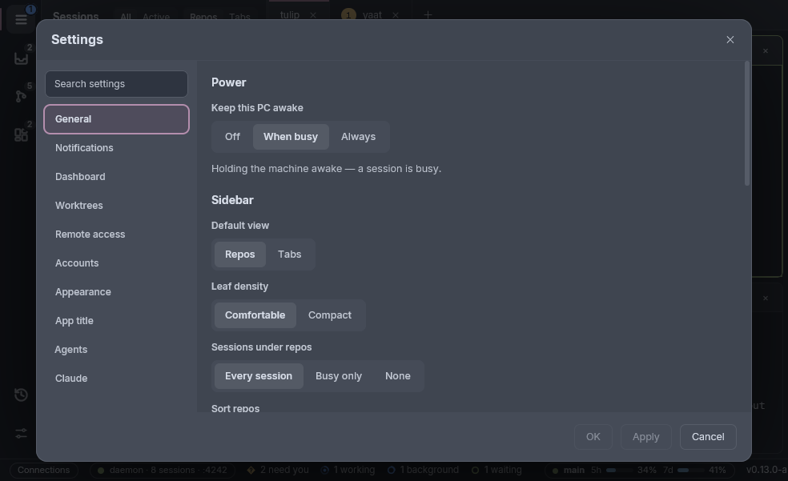

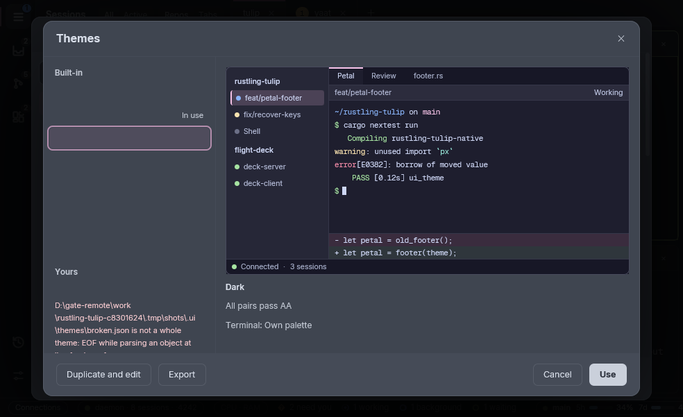

## Install

On Windows:

1. Install [Claude Code](https://github.com/anthropics/claude-code) and check that `claude` runs from a terminal: rustling-tulip finds it on your `PATH`.
2. Download `rustling-tulip-<version>-setup.exe` from the [latest release](https://github.com/leftos/rustling-tulip/releases/latest) and run it. It installs for your user only, with no administrator prompt, and can start the daemon when you log in.
3. The installer and the app are signed with a verified publisher, so Windows names who made them. While the signature is new, SmartScreen may still warn on first run: choose More info, then Run anyway.

On a Mac with Apple silicon (there is no build for Intel Macs):

1. Install [Claude Code](https://github.com/anthropics/claude-code) and check that `claude` runs from a terminal.
2. Download `rustling-tulip-<version>-macos-arm64.dmg` from the [latest release](https://github.com/leftos/rustling-tulip/releases/latest), open it and drag rustling-tulip into Applications. The app is signed and notarized, so it opens without a warning.
3. Run it from Applications: a copy run from the disk image or from Downloads cannot update itself.
4. Secret environment rows need Windows Credential Manager, so on a Mac a session with a secret row will not start; give it the secret through an `${env:NAME}` row instead.

Remote access over Tailscale needs [Tailscale](https://tailscale.com/) on both PCs, signed in to the same tailnet, with HTTPS certificates turned on for it. Remote access over SSH needs only an SSH login to the other PC.

## What's new in v0.10.0-alpha

- rustling-tulip now runs on Apple silicon Macs, as a signed and notarized .dmg that updates itself.
- Save several Claude logins, see each one's usage in the footer, and switch accounts by hand or let auto-switch do it.
- On Windows, a Gates view shows this PC's gate slots, queue and recent runs, and sets each pool's slot count.
- Pick each host's default shell, and a Claude you start by hand in a shell gets Chat and Summary too.

The full list is in the [release notes](https://github.com/leftos/rustling-tulip/releases/tag/v0.10.0-alpha).

## What's new in v0.9.0-alpha

- Ctrl+click a folder path in a remote host's terminal to fetch the whole folder, or fetch a fetched file's whole folder from its notice.
- Settings has a search box that finds any setting, and OK, Apply and Cancel so changes wait until you confirm them.
- The chat stays a readable width, sets each final answer apart, and folds runs of tool calls into one line in Compact mode.
- The installer and the app are signed with a verified publisher, and update notices show what's new since your version.

The full list is in the [release notes](https://github.com/leftos/rustling-tulip/releases/tag/v0.9.0-alpha).

## What's new in v0.8.1-alpha

- A newly started Claude session no longer shows as Finished, or raises a Finished toast, before you have used it.

The full list is in the [release notes](https://github.com/leftos/rustling-tulip/releases/tag/v0.8.1-alpha).

## What's new in v0.8.0-alpha

- The Dashboard shows every running agent at a glance and answers their questions and permission prompts with one click.
- On Windows, the app's own toasts answer a prompt or go to its pane without taking focus, with softer chimes.
- `rustling-tulipd` drives sessions from a shell: list, spawn, send, read, wait and watch.
- Sessions run as administrator are kept apart: programs without administrator rights can no longer start or reach them.

The full list is in the [release notes](https://github.com/leftos/rustling-tulip/releases/tag/v0.8.0-alpha).

## What's new in v0.7.2-alpha

- A Finished toast no longer fires when a Stop hook sends the agent back to work; the session stays Working until its hooks finish.

The full list is in the [release notes](https://github.com/leftos/rustling-tulip/releases/tag/v0.7.2-alpha).

## What's new in v0.7.1-alpha

- Finished toasts no longer fire after nearly every tool call while Claude works through a task-list item.
- A Finished toast now waits 5 seconds and is dropped if the session starts working again.

The full list is in the [release notes](https://github.com/leftos/rustling-tulip/releases/tag/v0.7.1-alpha).

## What's new in v0.7.0-alpha

- Tail a log a chat command writes, in a scrolling box under its card that follows the file as it grows.
- Hear when an agent needs you, and on Windows see the Needs you count as a badge on the taskbar button.
- Start sessions faster: a Spawn submenu on every repo and workspace, a target dropdown, and a remembered Trusted choice.
- A quieter app: toasts and banners no longer narrate what you can already see.

The full list is in the [release notes](https://github.com/leftos/rustling-tulip/releases/tag/v0.7.0-alpha).

## What's new in v0.6.1-alpha

- The coloured frame round a session's terminal is 1 px by default, and a Frame width setting sets it from off to 6 px for the app, a repo, a workspace or one session.
- A Claude session working on a task-list item no longer shows as idle mid-turn or sends a false Finished notification.

The full list is in the [release notes](https://github.com/leftos/rustling-tulip/releases/tag/v0.6.1-alpha).

## What's new in v0.6.0-alpha

- Several hosts in one window: this PC and every saved host you switch on connect at once, the sidebar groups sessions by host, and spawning, shells, presets and Settings work on any of them.
- A chat view and a summary view for Claude sessions, with prompt cards, a message box and a strip of the work still running.
- Themes: pick a built-in theme or make your own in the Themes window; the default look is now Nord with the Inter font.
- Interface text size and weight settings, and a terminal weight setting from Regular to Bold.
- Tab pills and the taskbar badge count the sessions that need you.
- Sessions running when Windows signs out, restarts or shuts down resume on their own at the next start, and many reliability fixes.

The full list is in the [release notes](https://github.com/leftos/rustling-tulip/releases/tag/v0.6.0-alpha).

## Building from source

See [docs/README.md](docs/README.md) for the layout, build commands and developer docs.

## License

MIT.
