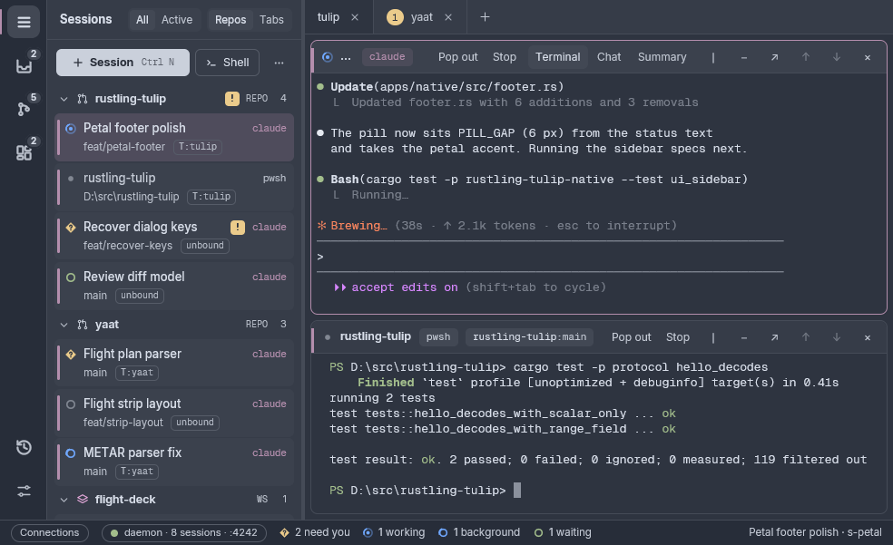
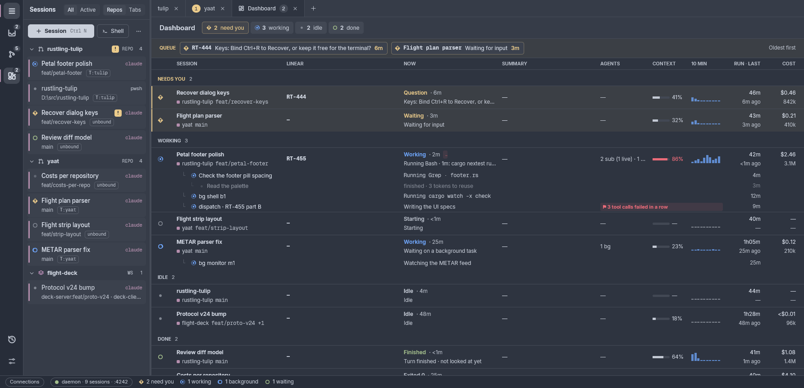
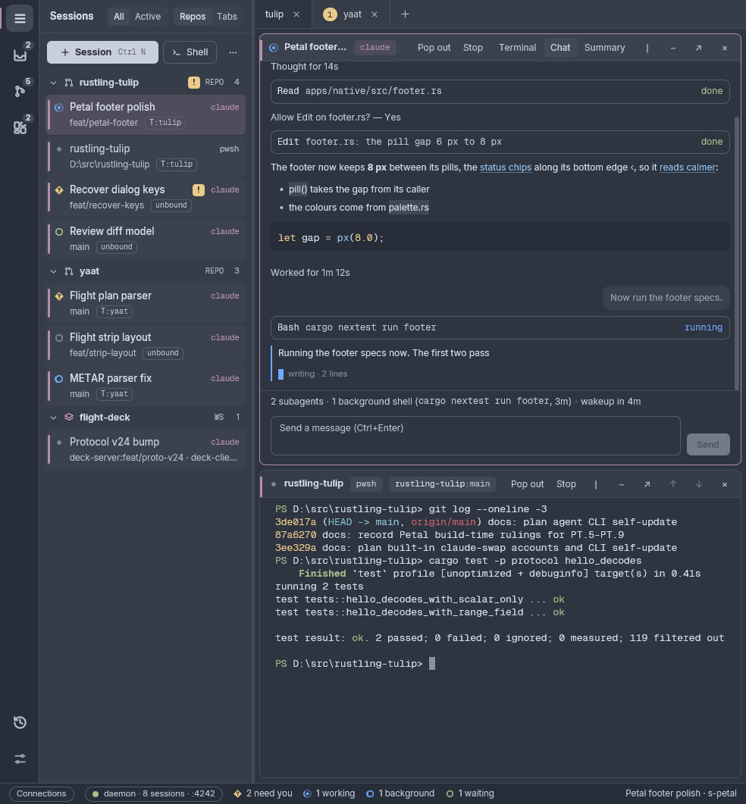
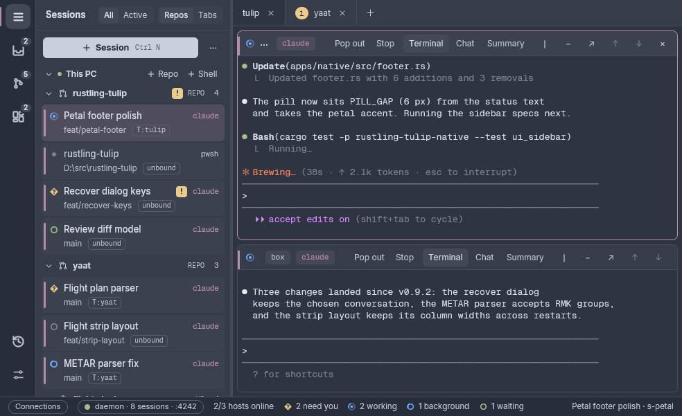
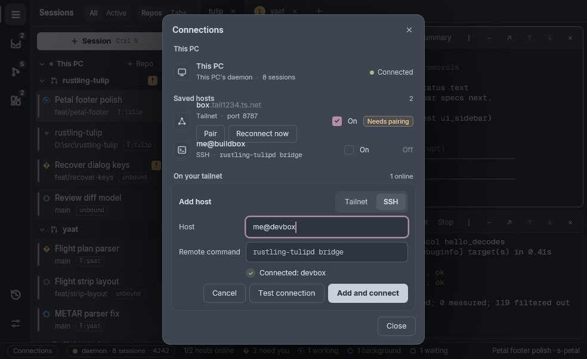
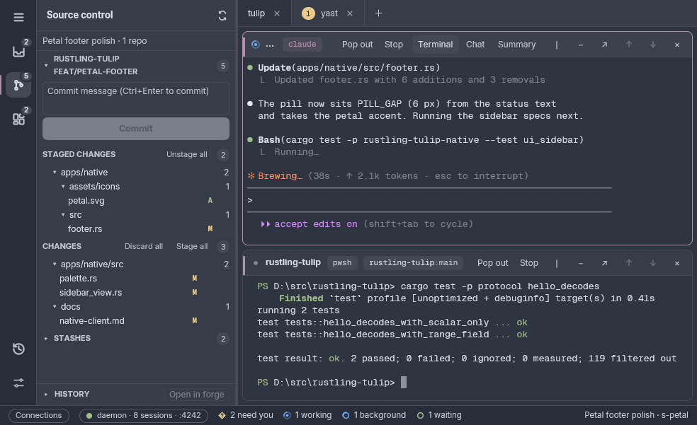
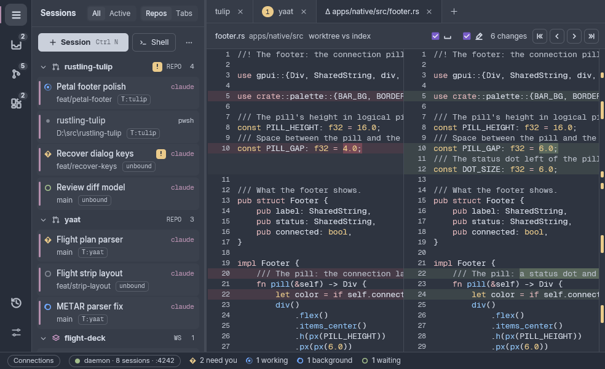
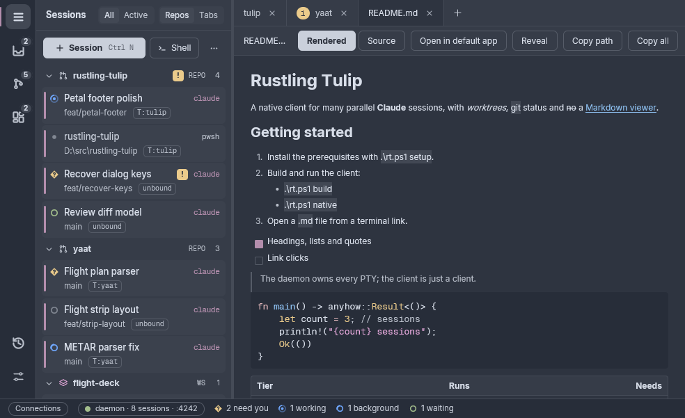
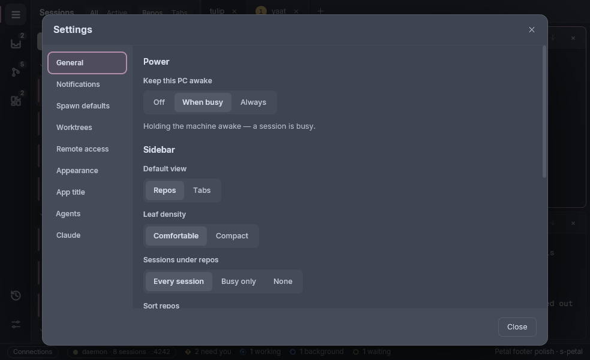
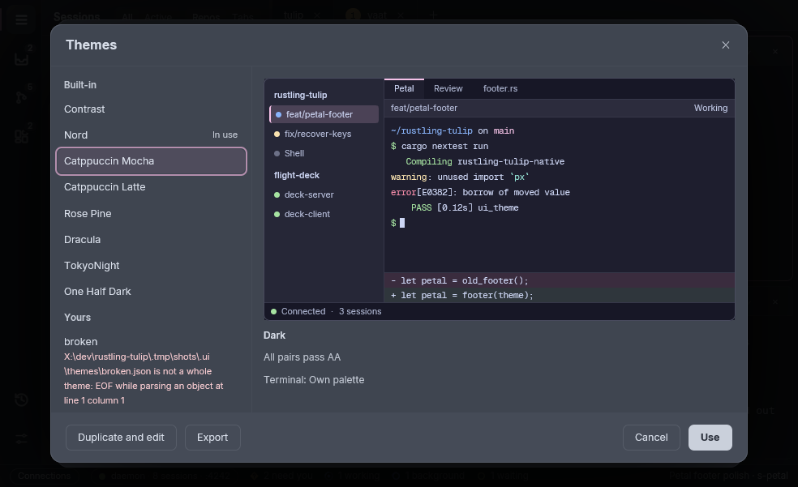

# rustling-tulip

rustling-tulip is a Windows desktop app for running many Claude Code sessions side by side, across your repos and multi-repo workspaces. A background daemon owns every terminal, so sessions keep running when you close the window and come back after a reboot. Each session can get its own git worktree and branch, and the sidebar shows which sessions are working, which have finished and which need you. It runs the `claude` CLI you already have; it never calls the Anthropic API itself.

It is alpha software, Windows only for now.

## Features

### Sessions and the sidebar

- Start a Claude session or a plain shell in a repo's own folder, or in a new git worktree on its own branch, so parallel sessions never edit the same checkout.
- Group repos into a workspace: one session works across all of them, with their relative paths kept. A VS Code `.code-workspace` file next to a repo is offered as a workspace.
- Every session's status has its own shape and colour: working, asking you something, finished while you were away, idle, or idle with background work still running.
- Tab pills and the window title count the sessions that need you, and show nothing at zero; Settings can show busy or idle counts instead.
- The Needs You panel lists every session waiting on you, longest wait first, with what each asks: its question, the tool it wants to run, or the plan to approve. A Windows notification fires when a session needs you or finishes (skipped when you are already looking at it).
- Each finished turn of a Claude session gets a one-line summary, kept across restarts, and the Finished notification is worded from it.
- The Dashboard tab, opened from the activity rail, lists every agent session by status: what each is doing now, its context, recent activity, cost and running subagents, with a queue of the sessions waiting on you.
- Open a repo's, workspace's or tab's menu from the keyboard with Shift+F10 or the Menu key.
- Tabs and split panes: drag a pane or a sidebar session onto a pane to split, swap or move it, rearrange a tab into a grid, and undo a closed tab or a moved pane.
- The sidebar groups sessions by repo or by tab, in Comfortable or Compact rows, and can show every session under a repo, only the busy ones, or just a count.
- Repos sort with the ones that need you on top, by latest activity, or in your own order, and an All / Active switch hides the repos and workspaces with nothing running.
- Launch again with one click: a repo's last launch settings are replayed from its row. Presets start many sessions at once from a prompts file, a folder or GitHub issue ranges, and on a remote host the wizard takes typed paths on that host.
- In the terminal, copying from Claude Code's boxed panels leaves out the borders, file paths and URLs open with Ctrl+click, shell commands get a pass/fail mark in the gutter with copy and re-run, and two header buttons jump between the prompts you sent.
- Terminal programs that ask for urxvt or pixel-precise mouse reporting get clicks, drags and the wheel in the format they asked for.
- When Claude exits, its pane stays a working shell.
- Secret environment values you give a session are stored in Windows Credential Manager, never in a settings file.

### Chat and summary views

- A Claude session's pane can show its conversation as a chat instead of the terminal (the pane's Chat button, its menu or Ctrl+Shift+M), with answers appearing as they are written. Each session remembers which view it was last shown in.
- Answer Claude's questions and permission prompts from cards, by click or key, and send messages from a box under the chat that keeps your text when a send is refused.
- A strip under the chat shows what is still running: subagents, background shells and the next wakeup, with their ages.
- The Summary view (Ctrl+Shift+U) shows a session as one line per stretch of work, each opening into its messages.
- Long replies written as expandable text open a short phrase into its longer form with a click, one level at a time.

### Several hosts in one window

- The app connects to this PC and every saved host you switch on, over Tailscale or SSH, and keeps each host's sessions, alerts and panels.
- The sidebar groups sessions by host, each with its own + Shell; remote panes and tabs carry their host's name, one tab can mix panes from several hosts, and an offline host dims until it reconnects.
- Spawning, shells, Add repo, presets and Settings work on any connected host: the spawn picker groups repos by host, and Settings has a host selector.

### Remote access over Tailscale

- Turn on remote access in Settings and your other PCs on your tailnet can open this PC's sessions. The daemon serves only your tailnet, over TLS with a Tailscale certificate.
- The host picker lists your tailnet machines and the hosts you saved, and the app connects to every saved host you have switched on when it starts.
- A new device has to be approved on the host PC with a one-time pairing code. The Devices list shows who is connected and when each device was last seen, and Block cuts a device off until you forget it.
- Ctrl+click a file path in a remote session's terminal, or use Fetch file…, to copy the file to this PC and open it. An HTML page brings its images and stylesheets with it.
- When a host's session count changed since your last visit, the app offers to keep your layout, open all its sessions or start empty.

### Remote access over SSH

- Without Tailscale, connect to another Windows PC over SSH: + Add host in the Connections picker, switched to SSH, takes an alias or user@host, and Test connection checks it first. SSH hosts are Windows PCs for now.
- The installer puts its folder on your user PATH (and uninstall takes it off), so `rustling-tulipd` runs by name from a terminal or an SSH login.

### Source control and diffs

- Each worktree's changes, staging, commit, discard, stashes, history and commit details, with a link to the commit on your forge.
- Side-by-side diffs with word-level changes, syntax colours, an overview ruler and F7 / Shift+F7 to step through changes.
- Deleting a worktree deletes its branch only when its commits have already landed; otherwise it asks, branch by branch.

### Text and Markdown viewer

- Ctrl+click a file path in the terminal and it opens in a read-only viewer tab with line numbers and syntax colours, scrolled to the line the path names.
- Markdown files open rendered (headings, lists, task boxes, tables, code blocks), with a Rendered / Source toggle. Links open, and `#heading` links scroll to the heading.
- Ctrl+F finds text, a click or drag selects whole lines to copy, and a tab re-reads its file when you come back to it and the file has changed.
- A setting sends text files to VS Code or your default app instead.

### Windows and pop-outs

- Pop a pane, a whole tab (a grid or a diff) or a session out into its own window, for a second monitor or a diff beside your work.
- A popped pane or tab leaves a card in the main window with Focus window and Dock back. Dock back returns it to the main window.
- Pop-out windows reopen where you left them the next time the app starts.

### Recovery after a reboot

- Sessions run under a small supervisor process each, so closing the window or restarting the daemon never kills them.
- After a reboot or a crash, Claude sessions resume on their own at the next start (`claude --resume`) in their old panes, with their names and colours, and a notice says how many came back.
- Anything that could not resume waits in Recover sessions, which lists the last 7 days of ended sessions with the lost ones ticked.

### Settings

- A page per agent: Claude's permission mode, its provider (Anthropic, or DeepSeek with your own `DEEPSEEK_API_KEY`), and its launch command, so you can run another program, an alias or extra arguments.
- Trusted launch by default, which notifications to show and when to skip them, and whether to keep the PC awake (off, while a session is busy, or always).
- Start the daemon at login, the folder worktrees go in, and Manage worktrees to clean up old ones.
- Appearance: themes for the whole window and its terminals (built-in ones, Nord by default, or your own), session accent colours, terminal and interface fonts (Inter, Geist, Schibsted Grotesk or any installed font), the interface's text size and weight, the terminal's weight per app, repo, workspace or session, font sizes per session or per tab, and the window title.
- The Themes window previews every theme with its contrast check, edits any colour of your own copy, and exports or imports theme files.

## Install

1. Install [Claude Code](https://github.com/anthropics/claude-code) and check that `claude` runs from a terminal: rustling-tulip finds it on your `PATH`.
2. Download `rustling-tulip-<version>-setup.exe` from the [latest release](https://github.com/leftos/rustling-tulip/releases/latest) and run it. It installs for your user only, with no administrator prompt, and can start the daemon when you log in.
3. The installer is not code-signed yet, so Windows SmartScreen warns on first run: choose More info, then Run anyway.

Remote access over Tailscale needs [Tailscale](https://tailscale.com/) on both PCs, signed in to the same tailnet, with HTTPS certificates turned on for it. Remote access over SSH needs only an SSH login to the other PC.

## What's new in v0.6.0-alpha

- Several hosts in one window: this PC and every saved host you switch on connect at once, the sidebar groups sessions by host, and spawning, shells, presets and Settings work on any of them.
- A chat view and a summary view for Claude sessions, with prompt cards, a message box and a strip of the work still running.
- Themes: pick a built-in theme or make your own in the Themes window; the default look is now Nord with the Inter font.
- Interface text size and weight settings, and a terminal weight setting from Regular to Bold.
- Tab pills and the window title count the sessions that need you.
- Sessions running when Windows signs out, restarts or shuts down resume on their own at the next start, and many reliability fixes.

The full list is in the [release notes](https://github.com/leftos/rustling-tulip/releases/tag/v0.6.0-alpha).

## Building from source

See [docs/README.md](docs/README.md) for the layout, build commands and developer docs.

## License

MIT.
