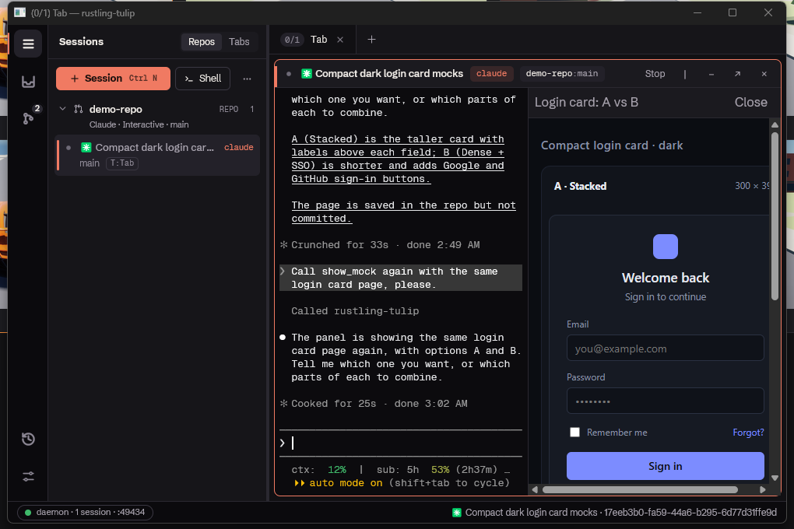

# Mock pane spike: Claude draws HTML/SVG into a pane beside its session

Branch `spike/mock-pane` (not landed). Question: can a Claude session in rustling-tulip show a visual (a UI mock, a diagram) right in the app, in a pane beside the session, the way Claude Desktop's visualize feature does, instead of publishing an Artifact or opening a browser?

Answer: yes. The whole loop works live on Windows with a real Claude Code session, after two WebView2-in-GPUI walls were found and worked around.

## What was built

- **Tool.** `rt-tracer mcp --session <id> --config-dir <dir>` (`crates/tracer/src/mcp.rs`) is a stdio MCP server with one tool, `show_mock(title, html)`. It reuses the hook shim's daemon proof and bearer (`crates/tracer/src/hook.rs`, `post_json`) to POST the page to the daemon.
- **Injection.** An interactive Claude spawn writes `sessions/<id>/mcp-config.json` beside `hook-settings.json` and passes `--mcp-config <file>` right after `--settings` (`crates/daemon/src/server/spawn/hook_settings.rs`, `crates/daemon/src/agents/claude.rs`). `--mcp-config` is variadic in the CLI, so only flags may follow it.
- **Daemon.** The loopback-only `POST /mock/{session_id}` route (`crates/daemon/src/server/mock.rs`) checks the bearer, writes `sessions/<id>/mock.html` and broadcasts `DaemonMessage::MockShown { session_id, title, path }` through `StateEvent`.
- **Client.** `apps/native/src/mock_view.rs`: a `MockPanel` per session, drawn as a 50/50 split inside that session's grid pane (header with title and Close), hosting a `wry` 0.57 WebView2 that loads the file URL. `RUSTLING_TULIP_MOCK_DEMO=<html>` opens a page beside the first session at startup.

## Findings

- **Claude reaches for the tool unprompted.** Asked "show me two side-by-side mock options for a compact login card" with no tool named, it called `show_mock` on its own. With the user's global CLAUDE.md loaded, it *also* ran that file's mock workflow first (a committed canvas page, a headless screenshot, an embedded review copy). A real build needs a line in the global instructions that a rustling-tulip session shows mocks with `show_mock`.
- **Wall 1: wry's build re-enters GPUI.** `build_as_child` waits for the WebView2 environment and controller in a nested message pump (`wry-0.57.0/src/webview2/mod.rs:369`, `:426`). Called from an element's prepaint, the pump re-entered GPUI's window procedure: 12 `RefCell already borrowed` errors in 1.3 s, then the window stopped repainting.

  `focus_parent` (`SetFocus`) and dropping a webview (`DestroyWindow`, `PARENT_DESTROY_MESSAGE`) message the parent synchronously too. Fix: every such call runs in a foreground task holding no GPUI borrow.
- **Wall 2: a child HWND is invisible under GPUI.** GPUI composes its window with `CreateTargetForHwnd(hwnd, true)`, a topmost DirectComposition target (`gpui-0.2.2/src/platform/windows/directx_renderer.rs:793`, window `WS_EX_NOREDIRECTIONBITMAP` at `window.rs:410`), so its frame draws above every child window: the webview built fine and showed nothing ([before](mock-pane/child-hwnd-blank.png)).

  Fix: the webview lives in a borderless owned popup (`WS_POPUP`, `WS_EX_TOOLWINDOW`, owner = the GPUI window) placed over the panel body in screen pixels, moved on layout changes and on `observe_window_bounds`.
- **Not tried: punching a hole.** The swap chain is premultiplied alpha (`directx_renderer.rs:1041`), so a child window would show through wherever GPUI paints alpha 0. That needs every background between the window root and the panel to skip the rect, so the popup was tried first and worked.
- **Overlays.** The popup paints above all of GPUI, so the panel hides itself while any modal, menu, flyout, the Settings modal, the connecting overlay or a pane/tab drag shows ([hidden under Settings](mock-pane/hidden-under-settings.png)). Toasts and the undo shelf are not in that list and get covered.
- **Checked live:** the page renders and scrolls; a second `show_mock` reloads the same panel; the panel hides under Settings and comes back; snapping the window to half the screen moved and resized the page with it. The WebView2 control took about 1.3 to 1.4 s from the broadcast to built.
- **Not checked live:** a split-divider drag, a sidebar collapse, a tab switch, the focus hand-back after clicking into the page, a DPI change, minimise and restore.

## Gaps left by the spike

- A panel lives only in the client: a client restart loses it until Claude calls the tool again. The daemon could replay the last `MockShown` per session on connect.
- A removed session's panel stays (hidden) until Close or exit.
- The recovered-shell and other spawn paths don't get `--mcp-config` (only the interactive Claude spawn does).
- One-way only: picks and notes the user makes in the page don't reach Claude. The popup's webview could post them back through an IPC handler and the same daemon route.
- The popup takes activation when clicked, so GPUI's window looks inactive while the page has focus.
- `wry` adds about 1,200 lines to `Cargo.lock` (mostly other platforms' crates); `cargo deny check` was not run.
- No tests for the `/mock` route's error answers or for the panel (WebView2 can't run under GPUI's test platform).

## Recommendation

Build it for real on the owned-popup route, as its own outcome: the daemon replays the last page per session on connect, the panel hides under toasts, Close and session removal tear it down, every Claude spawn path gets the tool, and `cargo deny` passes with `wry`. Then two-way picks through wry's IPC handler as the next step, since choosing between mock lanes is what the user does with them.

## Rulings after the spike

- **HTML is the medium; no drawing tools.** Claude draws by writing one HTML/CSS/SVG/canvas page per `show_mock` call. A set of drawing primitives (`draw_rect`, `draw_text`, …) would be a weaker SVG: a round trip per shape, no layout engine, no fonts or CSS, no interaction. A mock that must match the GPUI client pixel for pixel is a `.\rt.ps1 native-shot` of the real client, not a panel page.
- **Pages load from an app scheme, not `file://`.** The spike loads `sessions/<id>/mock.html` as a `file://` URL (`apps/native/src/mock_view.rs`, `file_url`). Chromium refuses ES-module imports and `fetch` from `file://` pages, which three.js and most current libraries need. The panel serves the page, its folder and the bundled libraries over a wry custom protocol (or WebView2's virtual-host folder mapping) instead. Which of the two to use is open.

## Follow-ups

Each is a sub-issue of RT-318, after the base build above.

- [ ] RT-355 **Bundled libraries.** The app ships a small pinned set of libraries and serves them to mock pages from the app scheme (for example `rt-lib://three/<version>/three.module.js`): three.js for 3D, one chart library (d3 or a smaller one) for data, and rough.js for sketch-style wireframes. The tool description lists each by name and URL, and replaces "no external files" with "no network; use the bundled libraries". The panel blocks network requests, so a page cannot pull a CDN copy. Confirm WebGL renders in the owned popup first; the spike did not try it.
- [ ] RT-356 **`show_mock` from a path.** The tool also takes `path` in place of `html`: a page already on disk (the `.tmp/mocks/<name>/index.html` review copies the global mock workflow writes), shown with its relative images, clips and models. Paths are limited to the session's working folders (its worktrees and `--add-dir` folders); anything else is refused with the reason. A reload on a later call re-reads the file, so Claude can edit the page and call again.
- [ ] RT-357 **`mock_screenshot`.** A second tool returns a PNG of the panel's rendered page, so Claude checks its own output (a blank canvas, a broken layout, overflow) before the user looks, as `render-svg` and `native-shot` let it today. WebView2's `ICoreWebView2::CapturePreview` captures the page; whether wry 0.57 exposes the `ICoreWebView2` it holds is unchecked. The capture travels client → daemon → MCP server, so it needs a request/reply path the spike's one-way `MockShown` does not have; the two-way picks work needs the same path, so the two share it.
- [ ] RT-358 **Two-way picks.** The page posts a pick or note through wry's IPC handler; the client sends it to the daemon, and Claude reads it (a tool result, or a message typed into the session). Booked from the recommendation above.
